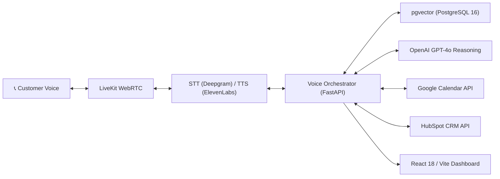

# VoxLead AI — Project Summary & Executive Report

**Project**: VoxLead AI — Autonomous AI Sales Voice Agent MVP  
**Architecture**: Modular Monolithic Architecture with Cascaded Voice AI  
**Deployment**: Docker & Docker Compose | Local Multi-Process  
**Repository**: [github.com/alfeenafsal11/voxlead-ai](https://github.com/alfeenafsal11/voxlead-ai)  

---

## 1. Executive Summary

**VoxLead AI** is an autonomous, enterprise-grade AI sales voice assistant designed to handle the entire inbound/outbound sales lifecycle without manual intervention:
1. **Engages prospective buyers** in low-latency, natural telephone conversations.
2. **Answers complex pricing and product inquiries** grounded in verified documentation via PostgreSQL/pgvector RAG with strict anti-hallucination guardrails.
3. **Conducts BANT qualification** and deterministically scores leads (0–100) into Hot, Warm, or Cold categories while analyzing customer sentiment.
4. **Checks calendar availability in real time**, avoids schedule collisions, and books product demonstrations with idempotency protection.
5. **Synchronizes customer records and deals** directly to HubSpot CRM and generates post-call intelligence summaries.
6. **Supports real-time multilingual communication** in English and Hindi, automatically detecting and maintaining the caller's language preference.

---

## 2. Technical Stack & System Architecture



- **Backend**: Python 3.11, FastAPI, Uvicorn, SQLAlchemy 2.0, Pydantic v2, PostgreSQL 16 + pgvector.
- **Frontend**: React 18, Vite, Lucide Icons, Dark SaaS UI with interactive waveform visualizer.
- **Voice & AI**: LiveKit Agents & WebRTC tokens, Deepgram streaming STT, OpenAI GPT-4o & text-embedding-3-small, ElevenLabs streaming TTS.
- **Business Integrations**: Google Calendar API v3, HubSpot CRM API v3, with dual-mode provider interfaces (production APIs + deterministic mock adapters).

---

## 3. Core Capabilities & Tested Workflow

| Phase / Feature | Implementation Detail | Status |
| :--- | :--- | :--- |
| **Foundation & DB** | 9 relational entities in PostgreSQL with pgvector cosine indexing; health endpoints (`/health`). | **Verified (100%)** |
| **RAG Knowledge Base** | 7 synthetic CRM markdown manuals; 500-token chunks with 75 overlap; cosine distance search; fallback guardrail. | **Verified (100%)** |
| **Lead Intelligence** | Deterministic BANT scoring (Budget 30, Timeline 25, Authority 20, Need 15, Size 10); sentiment classification. | **Verified (100%)** |
| **Voice Agent** | LiveKit session token generation; conversational prompt asking 1 question at a time; English & Hindi support. | **Verified (100%)** |
| **Integrations** | Google Calendar slot availability & collision avoidance; idempotency key protection; HubSpot contact/deal sync. | **Verified (100%)** |
| **Call Intelligence** | Post-call summary generation; action item extraction; automatic CRM pipeline updates. | **Verified (100%)** |
| **Frontend Dashboard** | 3 pages: Sales Overview (KPIs), Live Voice Agent (interactive transcript & mic), Lead Management (searchable table). | **Verified (100%)** |

---

## 4. Verification & Quality Assurance

- **18 Automated Test Cases** covering all 7 phases:
  - `backend/tests/test_rag.py`: Ingestion, vector persistence, cosine retrieval, safe fallbacks, and memory lifecycle.
  - `backend/tests/test_leads.py`: Lead extraction, deterministic scoring, sentiment categorization, and DB updates.
  - `backend/tests/test_integrations.py`: Calendar slot verification, duplicate booking prevention, and CRM synchronization.
  - `backend/tests/test_workflow.py`: End-to-end sales scenario (45-rep company, $50k budget, 30-day timeline) + negative guardrails.
- **Test Result**: `18 passed in 1.82s` (0 failures, 0 warnings).

---

## 5. Quick Start Commands

```bash
# 1. Seed knowledge base and demo leads
python scripts/seed_demo_data.py

# 2. Start FastAPI Backend (Port 8000)
uvicorn backend.app.main:app --host 0.0.0.0 --port 8000

# 3. Start React Frontend (Port 5173)
cd frontend && npm install && npm run dev

# Or run with Docker Compose:
docker-compose up --build
```
