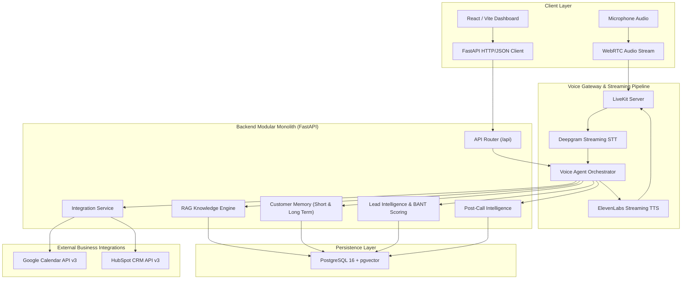
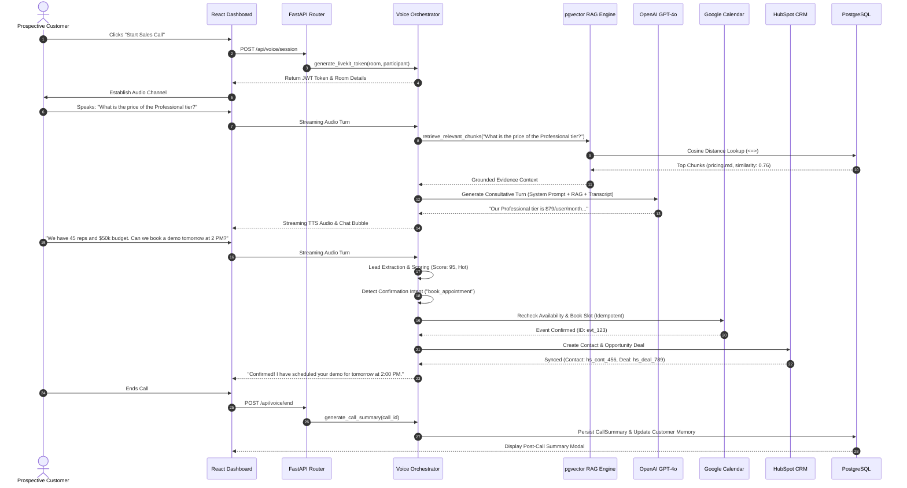

# VoxLead AI: Architecture & System Design

## 1. High-Level Architecture Overview

VoxLead AI is engineered as a modular monolith optimized for low-latency conversational voice reasoning, semantic knowledge retrieval, deterministic lead scoring, and automated business system synchronization.

The architecture decouples heavy external AI services behind provider interfaces, allowing seamless swapping between production AI engines (OpenAI, Deepgram, ElevenLabs, Google Calendar, HubSpot) and deterministic local mock adapters without modifying core domain logic.

---

## 2. Component Responsibilities

| Component | Responsibility | Technology |
| :--- | :--- | :--- |
| **Frontend UI** | Real-time sales overview, interactive voice agent with animated waveform, lead management & appointment booking. | React 18, Vite, Lucide Icons, Vanilla CSS |
| **FastAPI Core** | API routes, authentication, lifespan management, health check probes. | FastAPI, Uvicorn, Pydantic v2 |
| **LiveKit Gateway** | Real-time WebRTC audio connection, session room tokens, turn activity detection. | LiveKit Agents & LiveKit API |
| **RAG Knowledge Pipeline** | Ingestion of markdown, PDF, and txt documents; chunking (~500 tokens with 75 overlap); cosine vector retrieval; anti-hallucination guardrails. | pgvector, OpenAI `text-embedding-3-small` / Deterministic Semantic pseudo-embeddings |
| **Customer Memory** | Short-term conversation state, language preference, pending confirmations, long-term profile, objections, and past interaction summaries. | PostgreSQL JSON / SQLAlchemy |
| **Lead Intelligence** | Deterministic BANT scoring (0-100), categorization (Hot/Warm/Cold), sentiment classification (Positive/Neutral/Negative/Frustrated). | Pydantic structured models |
| **Business Integrations** | Calendar slot checking, conflict avoidance, idempotent appointment booking, HubSpot contact deduplication & deal pipeline creation. | Google Calendar API v3, HubSpot CRM API v3, Mock Adapters |
| **Post-Call Intelligence** | Automated post-call summary generation, key insight extraction, action items logging, CRM auto-sync. | OpenAI LLM / Deterministic Summarizer |

---

## 3. End-to-End Conversational Sequence Diagram

