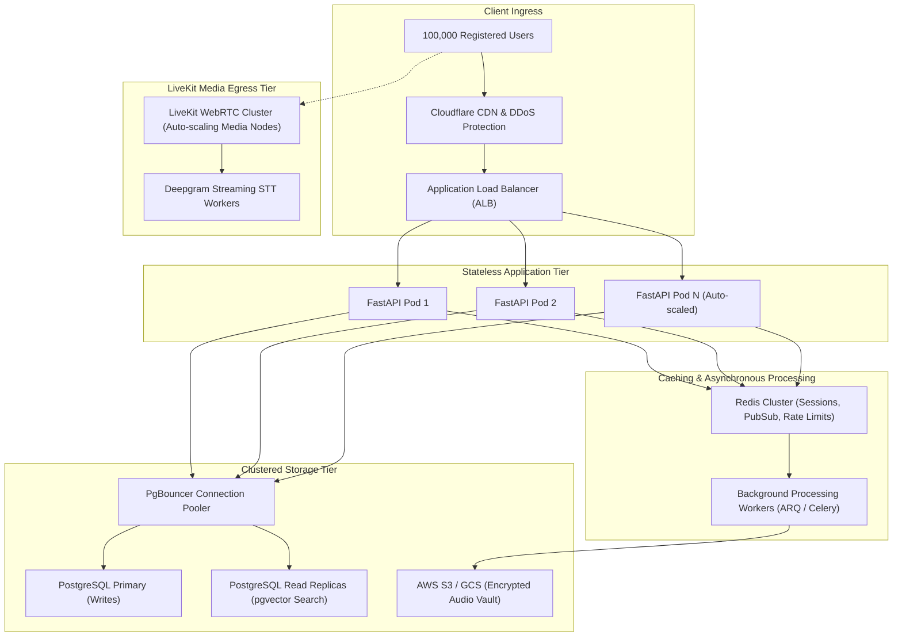

# VoxLead AI: Scalability Architecture & Capacity Strategy

## 1. Scaling Strategy for 100,000 Registered Users

Serving 100,000 registered enterprise users requires distinguishing **registered users** from **active concurrent voice calls**.

In standard B2B SaaS workloads:
- 100,000 registered users typically generate ~10,000 daily active users (DAU).
- Average sales calling concurrency peaks at approximately 2% to 5% of DAU.
- Peak concurrent voice calls: **200 to 500 concurrent sessions**.



---

## 2. Infrastructure & Component Scaling

### 2.1 Stateless FastAPI Application Layer
- **Horizontal Pod Autoscaling (HPA)**: Containerized backend pods running under Kubernetes (EKS/GKE), scaling on CPU utilization (> 70%) and request latency thresholds.
- **Stateless Handlers**: All session state resides in PostgreSQL and Redis, allowing any backend pod to service any request.

### 2.2 LiveKit WebRTC Worker Nodes
- Real-time media traffic is handled directly by LiveKit media nodes deployed across edge regions.
- Media nodes auto-scale based on active WebRTC room count and bandwidth consumption.

### 2.3 PostgreSQL & pgvector Optimization
- **PgBouncer Pooling**: Sits in front of PostgreSQL to handle thousands of concurrent client connections with low memory overhead.
- **Read Replicas**: Route dashboard analytics and lead search queries to read replicas while directing writes to the primary node.
- **HNSW Vector Indexing**: Replace flat vector scans with Hierarchical Navigable Small World (HNSW) indexes for sub-10ms vector lookups:
  ```sql
  CREATE INDEX idx_document_chunks_hnsw 
  ON document_chunks 
  USING hnsw (embedding vector_cosine_ops)
  WITH (m = 16, ef_construction = 64);
  ```

### 2.4 Redis Introduction for High-Throughput Caching
- **Distributed Session Cache**: Stores live conversation context to avoid database roundtrips during rapid speech turns.
- **Rate Limiting**: Enforces tenant-level and IP-level token bucket rate limits.
- **Asynchronous Task Queue**: Offloads audio file compression, post-call summary generation, and CRM bulk exports.

### 2.5 Object Storage for Call Audio
- Audio streams are written directly to Amazon S3 or Google Cloud Storage with server-side AES-256 encryption.
- Short-lived pre-signed URLs (15-minute expiration) are generated on demand for playback in the dashboard.

---

## 3. Illustrative Capacity Planning Scenario: 500 Concurrent Calls

> [!NOTE]
> The following figures represent an **illustrative capacity planning model** for 500 concurrent voice calls and are labeled as an **unvalidated target** subject to empirical load testing.

### Bandwidth & Compute Calculations (500 Concurrent Calls)

| Resource | Per-Call Assumption | Aggregate for 500 Calls | Sizing Recommendation |
| :--- | :--- | :--- | :--- |
| **Voice Audio Bandwidth** | 64 kbps (Opus codec, bidirectional) | 64 Mbps total bandwidth | Multi-AZ 1 Gbps direct connect |
| **STT Ingestion** | 16 kHz streaming raw PCM | ~128 kbps per channel | Distributed LiveKit egress to Deepgram |
| **LLM Inference Turns** | ~1 turn every 6 seconds = 0.17 req/sec | ~83.3 LLM requests/second | OpenAI Enterprise Tier with dedicated TPM |
| **Database Transactions** | ~2 writes per turn (message + memory) | ~166 TPS write workload | PostgreSQL db.r6g.2xlarge (32 GB RAM, 8 vCPUs) |
| **Backend CPU / Memory** | 0.05 vCPU, 50 MB RAM per active call | 25 vCPUs, 25 GB RAM | 6 pods of 4 vCPUs / 8 GB RAM |

---

## 4. Operational Costs & Commercial Feasibility

Estimated monthly cost breakdown for 500 concurrent calls at 25% average utilization (approx 90,000 voice hours / month):

| Service | Unit Rate | Monthly Projected Cost |
| :--- | :--- | :--- |
| **Deepgram Streaming STT** | $0.0043 / min | ~$23,200 |
| **OpenAI GPT-4o Inference** | ~$0.015 / turn average | ~$28,000 |
| **ElevenLabs Streaming TTS** | ~$0.012 / min | ~$64,800 |
| **LiveKit Cloud / Self-hosted Media Nodes** | 8 x c6g.xlarge instances | ~$1,800 |
| **Managed PostgreSQL (RDS Aurora) & Redis** | Multi-AZ Primary + 2 Replicas | ~$1,650 |
| **Application Kubernetes Cluster (EKS)** | Compute pods + ingress ALB | ~$1,200 |
| **Total Estimated Operating Cost** | | **~$120,650 / month** |

**Commercial Viability Analysis**:
- 500 concurrent calls support approximately 5,000 to 10,000 sales reps.
- At an average Professional / Enterprise subscription of $79 to $149 per seat per month:
  - Monthly Recurring Revenue (MRR) for 5,000 seats: **$395,000 to $745,000**.
  - Gross Margin: **69% to 83%**, demonstrating robust unit economics and strong commercial feasibility.
